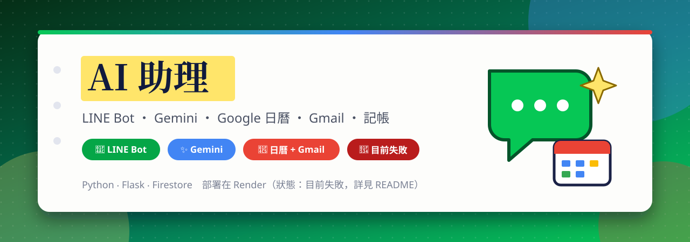
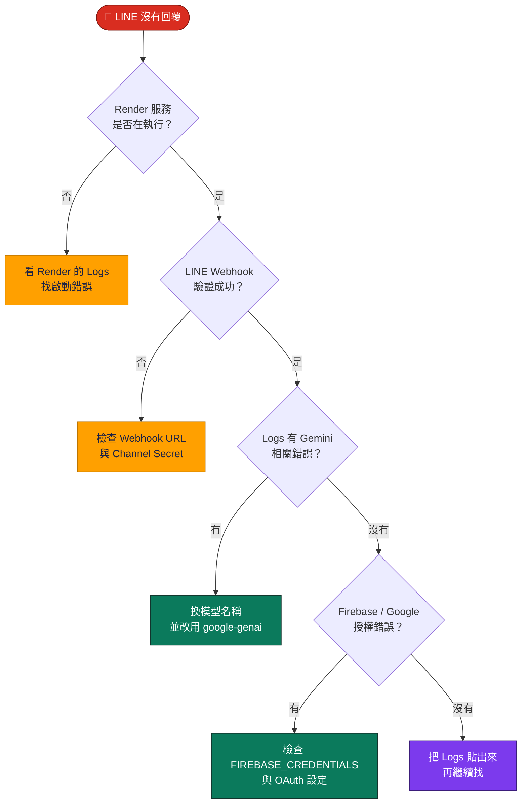
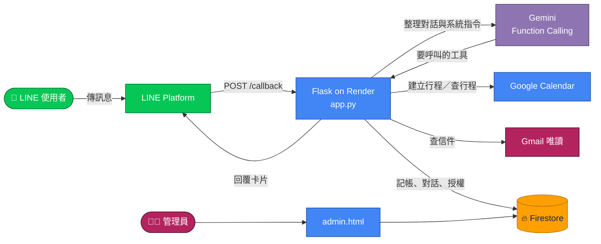

<a id="top"></a>

<div align="center">



<br>

[](#-目前狀態失敗)
[](https://github.com/Jiachang1112/AI-Assistant)
[](https://github.com/Jiachang1112)

[](https://www.python.org/)
[](https://flask.palletsprojects.com/)
[](https://gunicorn.org/)
[](https://developers.line.biz/en/docs/messaging-api/)
[](https://ai.google.dev/)
[](https://developers.google.com/calendar)
[](https://developers.google.com/gmail/api)
[](https://firebase.google.com/)
[](https://firebase.google.com/docs/firestore)
[](https://render.com/)

**用 LINE 聊天就能建立 Google 日曆行程、記帳、查 Gmail ‧ Gemini 負責理解你說的話**

<br>

[](#-目前狀態失敗)
[](#-特色)
[](#-快速開始)
[](#-環境變數)
[](#-部署到-render)
[](#-常見問題)

</div>

---

## 🔴 目前狀態：失敗

> **這個專案目前無法正常運作。** 這份 README 先如實標記，並整理出可能的原因與修法，之後修好再改回來。

| 項目 | 狀態 |
| --- | --- |
| LINE 機器人回覆 | 🔴 目前失敗 |
| 程式本身（`app.py`） | 🟢 設定好環境變數後可以正常載入、路由可用 |
| 已確認的原因 | ⚪ 尚未確認，需要看 Render 的執行紀錄 |

### 可能的原因

程式碼用的是已經過時的 Gemini 相關設定，這是最可疑的地方：

| # | 可能原因 | 說明 | 怎麼修 |
| --- | --- | --- | --- |
| 1 | **模型已下架** | `app.py` 寫死使用 `gemini-2.0-flash`，Google 已公布這個模型的停用時間（2026 年 6 月 1 日），停用後呼叫會失敗 | 改用目前仍提供的 Gemini 模型，查看 [Gemini API 棄用說明](https://ai.google.dev/gemini-api/docs/deprecations) |
| 2 | **舊版套件已停止支援** | `requirements.txt` 用的 `google-generativeai` 已經結束支援 | 改用新的 [`google-genai`](https://ai.google.dev/gemini-api/docs/libraries) 套件 |
| 3 | **環境變數遺失** | Render 上少了任何一個必要變數，程式啟動時只會記錄錯誤 | 對照下方[環境變數](#-環境變數)表逐項檢查 |
| 4 | **LINE Webhook 設定** | Webhook URL 或 Channel Secret 不對，LINE 的請求會被簽章檢查擋下 | 到 [LINE Developers](https://developers.line.biz/console/) 重新驗證 Webhook |
| 5 | **Google 授權失效** | OAuth 的重新導向網址與 Render 網址不一致，或 Google 憑證過期 | 到 [Google Cloud Console](https://console.cloud.google.com/apis/credentials) 檢查 |
| 6 | **Render 免費方案休眠** | 閒置後第一則訊息會逾時 | 改用付費方案，或用外部服務定時喚醒 |

### 排查順序



---

## ✨ 特色

<table>
<tr>
<td width="33%" valign="top">

### 🗓️ 說一句話就建行程
「明天早上 9 點開會」，Gemini 會判斷時間與事項，直接在你的 Google 日曆建立行程，並回一張 LINE 卡片。

</td>
<td width="33%" valign="top">

### 💰 聊天記帳
輸入品項與金額就會記進帳本，卡片上顯示目前餘額，並附上編輯連結。

</td>
<td width="33%" valign="top">

### 📧 查 Gmail
問「查詢未讀信件」，會列出信件清單與摘要，也能用 `from:`、`subject:` 等語法搜尋。

</td>
</tr>
<tr>
<td valign="top">

### 🔗 Google 帳號綁定
在 LINE 輸入「登入」取得綁定連結，授權日曆與 Gmail（唯讀）。輸入「登出」即可解除。

</td>
<td valign="top">

### 🎭 自訂語氣
可以設定機器人的說話角色與風格，並記住每位使用者的對話紀錄，需要時能一鍵清空。

</td>
<td valign="top">

### 📊 網頁報表與後台
`/journal` 是收支日記網頁，`admin.html` 是管理員後台，皆讀取 Firestore 資料。

</td>
</tr>
</table>

### 💬 LINE 上的快捷按鈕

| 按鈕 | 做什麼 |
| --- | --- |
| 📊 查看報表 | 開啟你的收支報表網頁 |
| 🔍 查詢行程 | 列出接下來的行程 |
| ➕ 新增範例 | 示範「明天早上 9 點開會」 |
| 🎭 設定角色 | 設定機器人的說話風格 |
| 🧹 清空對話 | 清除這位使用者的對話紀錄 |
| 📧 查詢信件 | 查詢未讀信件 |
| 🔗 綁定 Google／👋 登出 | 綁定或解除 Google 帳號 |

---

## 🧩 運作方式



1. 使用者在 LINE 傳訊息，LINE 以 `POST /callback` 通知你的 Flask 服務，並附上簽章供驗證。
2. 程式讀取該使用者的對話紀錄與語氣設定，連同系統指令一起交給 Gemini。
3. Gemini 判斷要不要呼叫工具：建立行程、查行程、記帳、查信件。
4. 程式實際執行工具（呼叫 Google API 或寫入 Firestore），再把結果組成 LINE 卡片回覆。

### 📁 檔案說明

```text
AI-Assistant/
├── app.py             Flask 主程式：LINE Webhook、Gemini、Google OAuth、Firestore
├── admin.html         管理員後台（Firebase 登入）
├── requirements.txt   Python 套件清單
└── assets/
    └── readme/        本 README 用的橫幅
```

### 🌐 路由

| 路徑 | 用途 |
| --- | --- |
| `GET /` | 健康檢查，回傳 `OK - Bot Running` |
| `POST /callback` | LINE Webhook 入口 |
| `GET /login?userid=…` | 開始 Google 授權 |
| `GET /oauth2callback` | Google 授權完成後回來的位置 |
| `GET /journal?userid=…` | 收支日記網頁 |

---

## ⚡ 快速開始

**1. 下載專案並安裝套件**

```bash
git clone https://github.com/Jiachang1112/AI-Assistant.git
cd AI-Assistant
python3 -m venv .venv && source .venv/bin/activate
pip install -r requirements.txt
```

**2. 設定環境變數**（見下一節）

```bash
export LINE_CHANNEL_ACCESS_TOKEN="..."
export LINE_CHANNEL_SECRET="..."
export GEMINI_API_KEY="..."
# 其他變數請看下表
```

**3. 啟動**

```bash
gunicorn app:app --bind 0.0.0.0:8000
```

LINE 的 Webhook 必須是 **公開的 HTTPS 網址**。在本機測試時，可以用 [ngrok](https://ngrok.com/) 之類的工具開一條通道，再把網址填到 LINE Developers 的 Webhook 設定。

---

## 🔑 環境變數

| 名稱 | 必填 | 說明 | 取得位置 |
| --- | :---: | --- | --- |
| `LINE_CHANNEL_ACCESS_TOKEN` | ✅ | LINE 機器人的存取權杖 | [LINE Developers](https://developers.line.biz/console/) |
| `LINE_CHANNEL_SECRET` | ✅ | 用來驗證 Webhook 簽章 | [LINE Developers](https://developers.line.biz/console/) |
| `GEMINI_API_KEY` | ✅ | Gemini API 金鑰 | [Google AI Studio](https://aistudio.google.com/apikey) |
| `GOOGLE_CLIENT_ID` | ✅ | Google OAuth 用戶端 ID | [Google Cloud Console](https://console.cloud.google.com/apis/credentials) |
| `GOOGLE_CLIENT_SECRET` | ✅ | Google OAuth 用戶端密鑰 | [Google Cloud Console](https://console.cloud.google.com/apis/credentials) |
| `FIREBASE_CREDENTIALS` | ✅ | Firebase 服務帳戶金鑰的 **JSON 全文** | [Firebase 主控台](https://console.firebase.google.com/) → 專案設定 → 服務帳戶 |
| `FLASK_SECRET_KEY` | 建議 | Session 加密用，請設成一長串隨機字串 | 自己產生 |

> 🔐 以上全部都是機密，**只能放在環境變數**，不要寫進程式碼或提交到 GitHub。

### 需要開啟的 Google 服務

在 [Google Cloud Console](https://console.cloud.google.com/apis/library) 啟用 **Google Calendar API** 與 **Gmail API**。OAuth 同意畫面的範圍包括：

- `calendar.events`（建立與讀取行程）
- `gmail.readonly`（唯讀信件）
- `userinfo.email`、`openid`（辨識帳號）

並在 OAuth 用戶端的「已授權的重新導向 URI」加入：`https://你的網域/oauth2callback`

---

## 🚀 部署到 Render

1. 到 [Render](https://dashboard.render.com/) 建立 **Web Service**，連結這個 GitHub 倉庫。
2. 設定：

| 欄位 | 值 |
| --- | --- |
| Runtime | Python 3 |
| Build Command | `pip install -r requirements.txt` |
| Start Command | `gunicorn app:app` |

3. 在 Environment 頁面填入上面的環境變數。
4. 部署完成後，把 `https://你的服務.onrender.com/callback` 填到 LINE Developers 的 **Webhook URL**，按「驗證」並開啟「Use webhook」。

---

## ⚠️ 注意事項

- **目前是失敗狀態**：請先看最上方的[排查順序](#排查順序)。
- **`OAUTHLIB_INSECURE_TRANSPORT`**：程式為了方便測試設成 `1`，會允許非 HTTPS 的 OAuth。正式環境請移除這一行，並只使用 HTTPS。
- **`FLASK_SECRET_KEY`** 沒設定時會使用預設字串，請務必自行設定。
- **`/journal?userid=…`** 目前只靠網址裡的 LINE 使用者 ID 辨識身分，知道別人 ID 的人可以看到他的收支。要公開使用的話，建議改成需要驗證的連結。
- **授權資料** 會存放在 Firestore，請確保 Firestore 規則不開放給一般使用者讀取。

---

## ❓ 常見問題

<details>
<summary><b>LINE 完全沒有回覆</b></summary>

先看 Render 的 Logs：

1. 有沒有 `環境變數未設定完全` 的錯誤 → 補齊環境變數。
2. 有沒有 Gemini 回傳 404／模型找不到 → 換掉 `app.py` 裡的模型名稱。
3. LINE Developers 的 Webhook 按「驗證」是不是成功。

</details>

<details>
<summary><b>綁定 Google 時出現 redirect_uri_mismatch</b></summary>

Google 的「已授權重新導向 URI」要和實際網址一模一樣，包括 `https://` 與結尾路徑 `/oauth2callback`。

</details>

<details>
<summary><b>Google 說這個應用程式未經驗證</b></summary>

OAuth 同意畫面還在「測試中」時，只有你加進「測試使用者」的帳號可以授權。請到同意畫面把要使用的 Gmail 加進去。

</details>

<details>
<summary><b>為什麼說了時間卻沒有建立行程</b></summary>

系統指令已要求 Gemini 遇到「時間 + 事項」就必須呼叫日曆工具；若仍然只回文字，可以輸入「清空對話」清除舊紀錄後再試。

</details>

<details>
<summary><b>怎麼進管理後台</b></summary>

開啟 `admin.html`（需要放到任何靜態網站空間），用管理員的 Google 帳號登入。Firebase 專案設定要和 `app.py` 使用的是同一個。

</details>

---

<div align="center">

[GitHub @Jiachang1112](https://github.com/Jiachang1112)　‧　[AI-Assistant](https://github.com/Jiachang1112/AI-Assistant)

[](#top)

</div>
